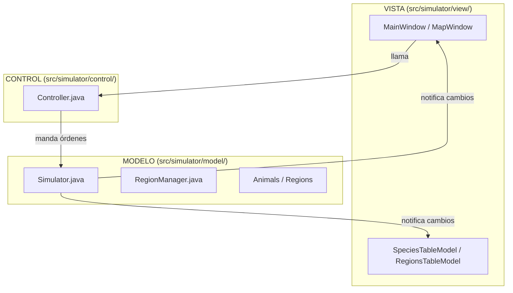
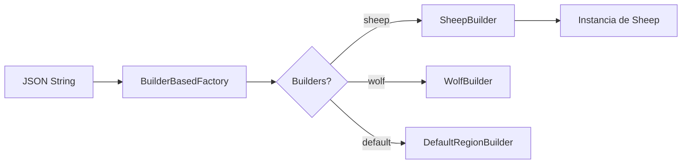
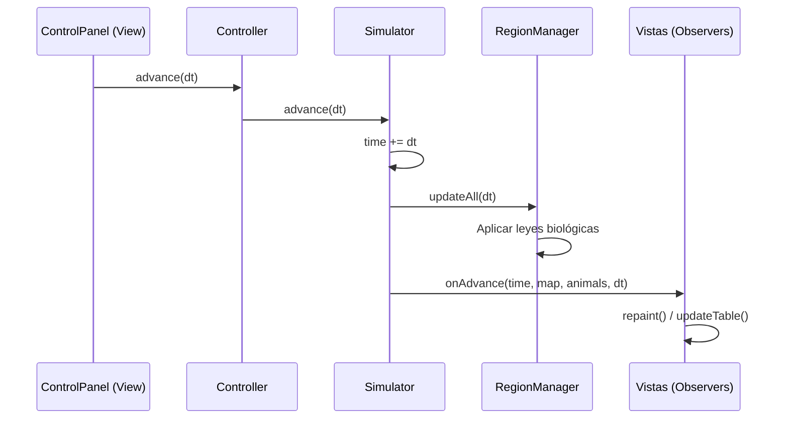
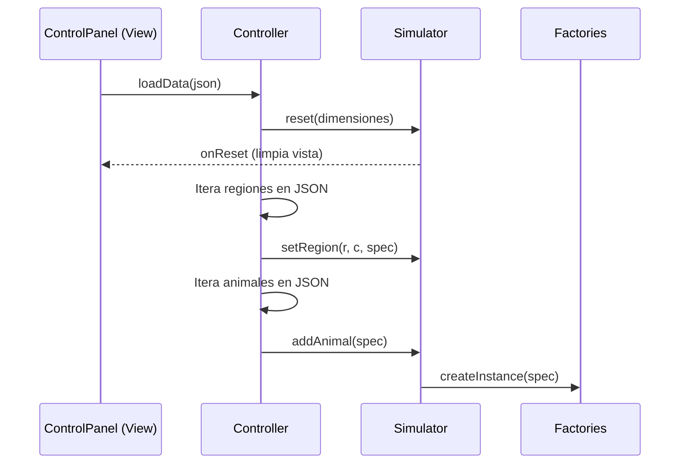

# 📚 Guía Completa del Proyecto: EcoSimulator

> Simulador biológico de ecosistemas con interacción dinámica entre especies y regiones.  
> Stack: **Java Swing**, patrón **MVC**, **Observer**, **Factory** y **Builder**.

---

## 📋 Índice

1. [Arquitectura General](#arquitectura-general)
2. [Modelo — El Motor Biológico](#modelo)
3. [Control — El Puente](#control)
4. [Vista — Interfaz Gráfica (GUI)](#vista)
5. [Factorías y Builders](#factorias)
6. [Flujos de Datos Principales](#flujos)
7. [Puesta en Marcha](#puesta-en-marcha)

---

## 🏗️ Arquitectura General {#arquitectura-general}

El proyecto sigue una arquitectura **MVC (Modelo-Vista-Controlador)** desacoplada mediante un patrón **Observer**.



| Capa | Paquete | Responsabilidad |
|------|---------|-----------------|
| **Presentación** | `view/` | Interfaz Swing. Escucha cambios del modelo mediante `EcoSysObserver`. |
| **Control** | `control/` | Gestiona el flujo de la simulación y la carga de datos. No tiene lógica biológica. |
| **Modelo** | `model/` | Contiene la lógica del ecosistema, las leyes biológicas y el estado de la simulación. |

---

## 🗄️ Modelo — El Motor Biológico {#modelo}

### Componentes Clave

| Clase | Responsabilidad |
|-------|-----------------|
| `Simulator` | Clase principal del modelo. Gestiona el tiempo (`time`) y la lista de animales y regiones. |
| `RegionManager` | Gestiona la cuadrícula de regiones y distribuye a los animales en sus respectivas celdas. |
| `Animal` | Clase abstracta base. Define el comportamiento de los animales (ovejas, lobos). |
| `Region` | Representa una celda del mapa con una cantidad de comida propia. |

### Jerarquía de Animales y Estados
Los animales pueden estar en diferentes estados definidos en `State.java`:
- `NORMAL`
- `HUNGER`
- `DANGER`
- `DEAD`

---

## 🔌 Control — El Puente {#control}

### `Controller.java`
Es la única vía que tienen las vistas para comunicarse con el simulador.

| Método | Descripción |
|--------|-------------|
| `loadData(JSONObject)` | Carga regiones y animales desde un JSON. |
| `advance(double dt)` | Avanza la simulación un paso de tiempo. |
| `reset(cols, rows, ...)` | Reinicia el simulador con nuevas dimensiones. |
| `addObserver(EcoSysObserver)` | Registra una vista para recibir actualizaciones. |

---

## 🖥️ Vista — Interfaz Gráfica (GUI) {#vista}

### Componentes Principales

| Vista | Descripción |
|-------|-------------|
| `MainWindow` | Ventana principal que organiza todos los paneles. |
| `ControlPanel` | Barra de herramientas con botones: Abrir (Open), Mapa (Map), Ejecutar (Run), Detener (Stop) y Salir (Exit). |
| `MapWindow` | Ventana secundaria que muestra el mapa visualmente. Contiene un `MapViewer`. |
| `MapViewer` | Se encarga del dibujo técnico: cuadrícula de regiones, círculos para animales y textos de ayuda. |
| `StatusBar` | Barra inferior que muestra el tiempo actual y el número de animales. |

### Modelos de Tabla
Las tablas se actualizan automáticamente gracias al patrón Observer:
- `SpeciesTableModel`: Muestra estadísticas por especie (código, dieta, estado).
- `RegionsTableModel`: Muestra info de cada celda (fila, columna, tipo de región, animales).

---

## 🏭 Factorías y Builders {#factorias}

El proyecto usa el patrón **Factory Method** combinado con **Builder** para crear objetos a partir de descripciones JSON.



Cualquier animal o región nueva debe tener su propio `Builder` registrado en `Main.java`.

---

## 🔄 Flujos de Datos Principales {#flujos}

### 1. Paso de Simulación (`advance`)



### 2. Carga de Configuración



---

## ⚙️ Puesta en Marcha {#puesta-en-marcha}

### Ejecución en modo GUI
La clase de entrada es [`Main.java`](file:///c:/Users/pable/OneDrive/Desktop/25-26/Segundo%20cuatri/TP2/Practicas/TP2-P1/src/simulator/launcher/Main.java).

**Argumentos por defecto:**
- `-m gui`: Inicia la interfaz gráfica.
- `-i <fichero>`: Opcional, carga un JSON al arrancar.

**Controles del Mapa:**
- `h`: Mostrar/Ocultar ayuda.
- `s`: Filtrar animales por estado (NORMAL, HUNGER, etc.).

---

## 📁 Estructura de Paquetes

```
src/simulator/
├── launcher/
│   └── Main.java             ← Punto de entrada
├── control/
│   └── Controller.java       ← Lógica de control
├── model/
│   ├── Simulator.java        ← Motor central
│   ├── Animal.java           ← Base de animales
│   ├── Region.java           ← Base de regiones
│   └── EcoSysObserver.java   ← Interfaz del observador
├── factories/
│   ├── Builder.java          ← Interfaz de constructor
│   └── WolfBuilder.java      ← Ejemplo de builder
└── view/
    ├── MainWindow.java       ← Ventana principal
    ├── ControlPanel.java     ← Barra de botones
    └── MapViewer.java        ← Dibujo del mapa
```
