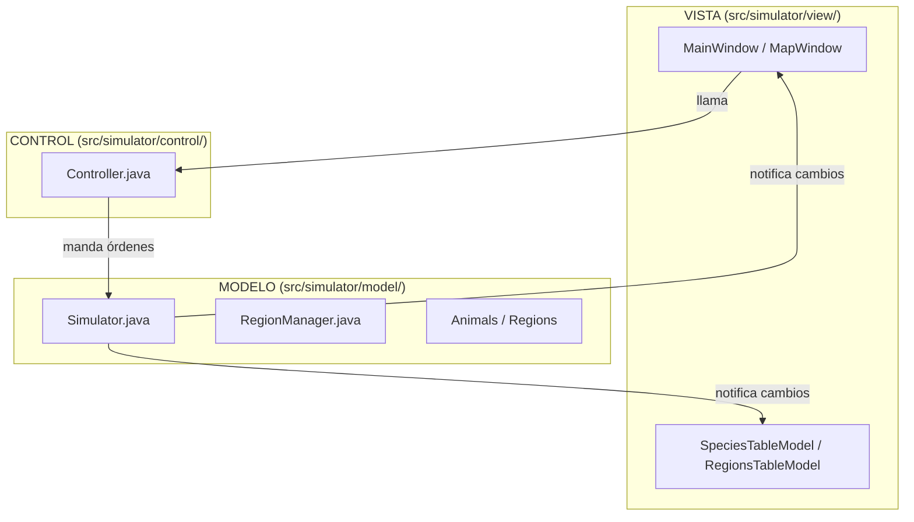
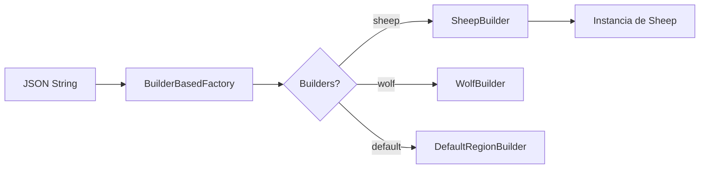
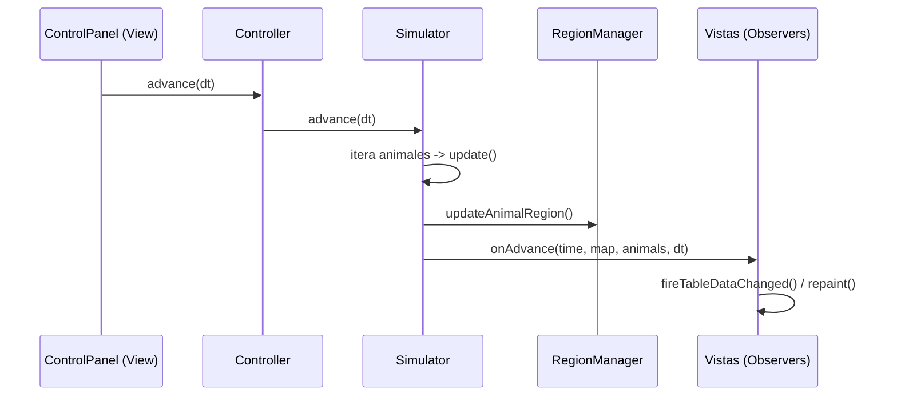
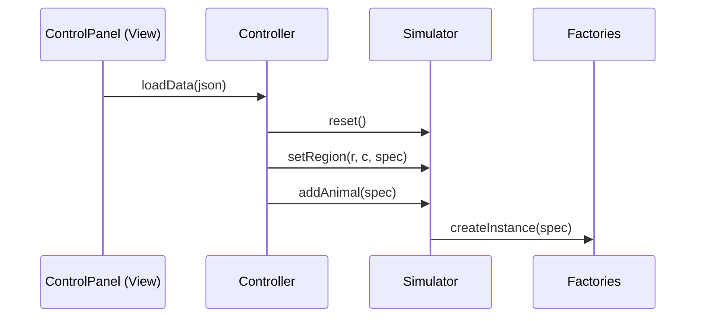

# 📚 Guía Completa del Proyecto: EcoSimulator (Versión Extendida)

> Simulador biológico de ecosistemas con interacción dinámica entre especies y regiones.  
> Stack: **Java Swing**, patrón **MVC**, **Observer**, **Factory**, **Builder** y **Strategy**.

---

## 🏗️ 1. Arquitectura General {#arquitectura-general}

El proyecto sigue una arquitectura **MVC (Modelo-Vista-Controlador)** desacoplada mediante un patrón **Observer**.



| Capa | Paquete | Responsabilidad |
|------|---------|-----------------|
| **Modelo** | `model/` | Contiene la lógica del ecosistema, las leyes biológicas y el estado de la simulación. |
| **Control** | `control/` | Gestiona el flujo de la simulación y la carga de datos. No tiene lógica biológica. |
| **Vista** | `view/` | Interfaz Swing. Escucha cambios del modelo mediante `EcoSysObserver`. |

### Patrones de Diseño Detallados
- **Observer**: `EcoSysObserver` permite que las vistas se actualicen automáticamente sin que el modelo las conozca directamente.
- **Factory Method + Builder**: Centraliza la creación de entidades desde JSON.
- **Strategy**: Utilizado en `SelectionStrategy` para que los animales elijan pareja/presa de forma intercambiable (`SelectClosest`, `SelectFirst`, `SelectYoungest`).
- **State**: Los animales gestionan su comportamiento mediante un estado interno (`NORMAL`, `HUNGER`, `MATE`, `DANGER`, `DEAD`).

---

## 🧬 2. Modelo — El Motor Biológico {#modelo}

### Componentes Clave

| Clase | Responsabilidad |
|-------|-----------------|
| `Simulator` | Orquestador principal. Gestiona el tiempo (`time`) y coordina el paso de simulación. |
| `RegionManager` | Gestiona la cuadrícula de regiones y la localización espacial de los animales. |
| `Animal` | Clase abstracta base que define atributos comunes (energía, edad, posición, velocidad). |
| `Region` | Representa una celda del mapa que provee alimento a los animales. |

### Lógica del Paso de Simulación (`advance`)
1. **Eliminar muertos**: Se quitan de la lista los animales en estado `DEAD`.
2. **Actualizar animales**: Cada animal ejecuta su `update(dt)` (movimiento, cambio de estado, gasto de energía).
3. **Actualizar posiciones**: El `RegionManager` comprueba si un animal ha cambiado de celda.
4. **Actualizar regiones**: Las regiones regeneran comida o aplican sus reglas.
5. **Nacimientos**: Se procesan los animales recién nacidos (`deliverBaby()`).
6. **Notificar**: Se llama a los observadores para refrescar la GUI.

### Jerarquía de Animales y Estados
- `Sheep`: Herbívoro. Teme a los carnívoros (`DANGER`), busca pareja (`MATE`) y come de la región.
- `Wolf`: Carnívoro. Busca presas cuando tiene hambre (`HUNGER`), busca pareja y no tiene depredadores.

---

## 🔌 3. Control — El Puente {#control}

### `Controller.java`
Es la única vía que tienen las vistas para comunicarse con el simulador.

| Método | Descripción |
|--------|-------------|
| `loadData(JSONObject)` | Itera sobre el JSON para configurar regiones y animales. |
| `advance(double dt)` | Ordena al simulador avanzar un paso. |
| `reset(cols, rows, ...)` | Reinicia el mundo con nuevas dimensiones. |
| `addObserver(EcoSysObserver)` | Registra una vista para recibir actualizaciones. |

---

## 🖥️ 4. Vista — Interfaz Gráfica (GUI) {#vista}

### Componentes Principales

| Vista | Descripción |
|-------|-------------|
| `MainWindow` | Frame principal (JFrame) que organiza los paneles. |
| `ControlPanel` | Barra con botones (`Open`, `Map`, `Run`, `Stop`, `Exit`) y spinner de pasos. |
| `MapWindow` | Ventana secundaria que contiene el `MapViewer`. |
| `MapViewer` | Dibujo técnico sobre un `JPanel`. Renderiza la rejilla y los animales. |
| `StatusBar` | Muestra el tiempo, número de animales y mensajes informativos. |

### Modelos de Tabla (Uso de `AbstractTableModel`)
- `SpeciesTableModel`: Columnas: Especie, Dieta, Estado, Población.
- `RegionsTableModel`: Columnas: Fila, Columna, Tipo, Alimento, Animales.
*Nota: Las tablas se actualizan solas al llamar a `fireTableDataChanged()` en `onAdvance`.*

---

## 🏭 5. Factorías y Builders {#factorias}

El proyecto usa el patrón **Builder** para parsear el JSON de forma extensible.



---

## 🔄 6. Flujos de Datos Principales {#flujos}

### 1. Paso de Simulación (`advance`)



### 2. Carga de Configuración



---

## 🛠️ 7. Guía de Modificaciones para el Examen {#modificaciones}

### A. Añadir una nueva Especie (ej: `Bird`)
1. Crear `Bird extends Animal`.
2. Implementar lógica de vuelo en `update`.
3. Crear `BirdBuilder extends Builder<Animal>`.
4. Registrar en `Main.java`: `animalsFactory.addBuilder(new BirdBuilder(...))`.

### B. Añadir una nueva Región (ej: `Water`)
1. Crear `WaterRegion extends Region`.
2. En `getFood`, devolver valores diferentes según el tipo de animal.
3. Crear `WaterRegionBuilder`.
4. Registrar en `Main.java`.

### C. Modificar Comportamiento
Si se pide que los lobos mueran al comer ovejas infectadas:
- Modificar `Wolf.doHunger` para detectar el estado de la presa antes de cambiar `energy`.

---

## 📝 8. Ejercicios de Práctica (Para LLM) {#ejercicios}

Si pasas esta guía a otra IA, pídele que resuelva:
1. **Challenge 1**: "Haz que las ovejas recuperen energía extra si están en una región de tipo `DynamicSupplyRegion`."
2. **Challenge 2**: "Crea una `SelectionStrategy` llamada `SelectWeakest` que elija al animal con menos energía."
3. **Challenge 3**: "Implementa un botón 'Nuclear' que mate al 50% de los animales aleatoriamente."

---

## ⚙️ 8. Puesta en Marcha {#puesta-en-marcha}

### Ejecución en modo GUI
Clase de entrada: [`Main.java`](file:///c:/Users/pable/OneDrive/Desktop/25-26/Segundo%20cuatri/TP2/Practicas/TP2-P1/src/simulator/launcher/Main.java).
**Argumentos:** `-m gui [-i input_file]`.

**Controles del Mapa:**
- `h`: Mostrar ayuda.
- `s`: Cambiar esquema de colores/filtros.

---

## 📁 9. Estructura de Paquetes {#paquetes}

```
src/simulator/
├── launcher/      ← Main.java
├── control/       ← Controller.java
├── model/         ← Simulator, Animal, Region, RegionManager, EcoSysObserver
├── factories/     ← Factory, Builder, WolfBuilder, etc.
├── view/          ← MainWindow, ControlPanel, MapViewer, TableModels
└── misc/          ← Utils, Vector2D
```

---
*Guía extendida para preparación de exámenes y soporte de desarrollo.*
